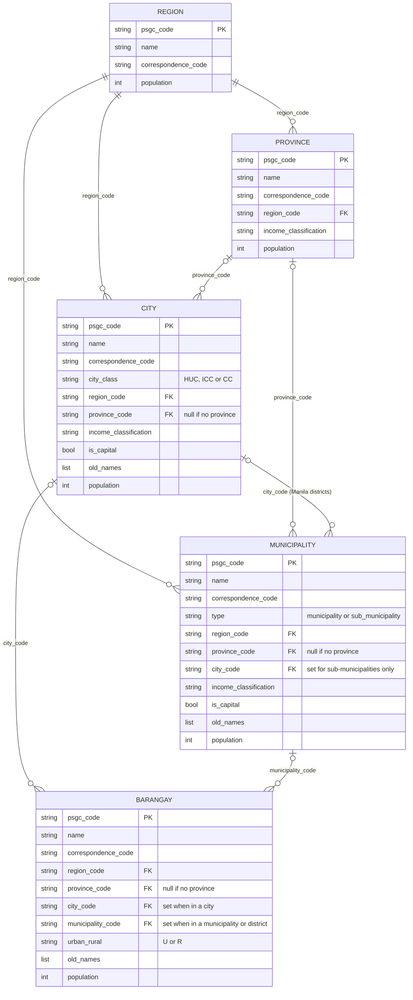

# Philippine Standard Geographic Code API (PSGC API)

> **Note:** This API is developed by an independent developer who wanted to provide a facility for accessing Philippine Standard Geographic Code (PSGC) locations and codes through API endpoints. It is not an official API of the Philippine Statistics Authority (PSA).

The Philippine Standard Geographic Code API (PSGC API) is an open API project designed to make Philippine geographic and administrative location data easier to access, understand, and integrate into applications.

The project provides a structured and developer-friendly way to work with geographic information based on the Philippine Standard Geographic Code (PSGC) system maintained by the Philippine Statistics Authority (PSA).

Instead of requiring developers to download, maintain, and manually process large geographic datasets, the PSGC API aims to provide a simple and consistent way to retrieve Philippine locations and their corresponding PSGC codes.

Whether you're building an address form, a location picker, an e-commerce checkout flow, a delivery platform, a government-related system, a research project, or any application that needs reliable Philippine location data, the PSGC API aims to provide a consistent foundation for working with Philippine geographic information.

## What is the PSGC?

The Philippine Standard Geographic Code is the official classification and coding system for the country's geographic and administrative areas. Each location is assigned a unique code, which makes it possible to identify a place accurately even when names are repeated, spelled differently, or changed over time.

For example, several towns across the country may share the same name, but each one has its own PSGC code. This makes the code a dependable reference for storing, matching, and sharing location data.

## How Philippine locations are organized

The PSGC follows the administrative structure of the Philippines, where each level sits inside the one above it:

| Level | Description |
| --- | --- |
| **Region** | The largest administrative grouping of provinces |
| **Province** | A group of cities and municipalities within a region |
| **City / Municipality** | Local government units within a province |
| **Sub-Municipality** | Districts within certain cities, such as the City of Manila |
| **Barangay** | The smallest administrative unit, found within every city and municipality |

Some cities, like those in the National Capital Region, are not part of any province. The PSGC API is designed to reflect these real-world relationships so you don't have to handle them yourself.

### How the resources connect

Each box is one resource with the fields it returns. `PK` is the location's own PSGC code; `FK` fields hold the PSGC code of a parent location. Each line is labelled with the field that links the two resources.

How to read the lines:

- `||--o{` means **exactly one parent, many children**. Every province, city, and municipality belongs to exactly one region.
- `|o--o{` means **zero or one parent, many children**. A city or municipality may have no province, and a barangay belongs to either a city or a municipality.

Things worth knowing:

- **Some places have no province.** Highly urbanized cities (such as the cities of Metro Manila), the City of Isabela, Pateros, and the municipalities of the BARMM Special Geographic Area link straight to their region, so their `province_code` is `null`.
- **Sub-municipalities** are returned by `/municipalities` with `type=sub_municipality`. They are the districts of the City of Manila, such as Tondo and Sampaloc, so their `city_code` is Manila's. Their barangays have both `city_code` (Manila) and `municipality_code` (the district).
- **Barangays also carry `region_code` and `province_code`**, so you can filter barangays by region or province directly, without first looking up the cities and municipalities.

All of these links come from the 10-digit PSGC code itself:

| Digits | Identifies | Example: Barangay Agtangao, `1400101001` |
| --- | --- | --- |
| First 2 | Region | `14` → `1400000000` (Cordillera Administrative Region) |
| First 5 | Province, or the parent city of a sub-municipality | `14001` → `1400100000` (Abra) |
| First 7 | City, municipality, or sub-municipality | `1400101` → `1400101000` (Bangued) |
| All 10 | The barangay itself | `1400101001` (Agtangao) |

## What you'll be able to do

Once the location endpoints are available, the PSGC API will let you:

- **Browse locations by level:** list all regions, provinces, cities, municipalities, or barangays
- **Explore the hierarchy:** get the provinces in a region, the cities and municipalities in a province, or the barangays in a city or municipality
- **Look up by code:** retrieve the full details of any location using its PSGC code
- **Trace a location upward:** find which city, province, and region a barangay belongs to
- **Search by name:** find locations quickly when you only know part of the name

## Why use the PSGC API?

- **Accurate:** based on the official PSGC published by the Philippine Statistics Authority
- **Consistent:** every location is identified by the same standard code used across government and statistical records
- **Convenient:** no need to download, clean, and maintain large spreadsheets yourself
- **Structured:** locations come with their parent and child relationships already connected
- **Easy to integrate:** clear, predictable responses that fit naturally into websites, apps, and systems

## Project goals

- Provide reliable endpoints for every level of Philippine location data
- Keep the data aligned with official PSA releases
- Make the API simple to understand for both beginners and experienced developers
- Offer clear documentation and examples
- Build a solid foundation that can grow with new features over time

## Project status

The PSGC API is in its early stages. The location endpoints for regions, provinces, cities, municipalities, and barangays are available, with filtering by PSGC code and pagination. A Bruno collection for trying them out is in `docs/bruno`.

## Data source

Location names and codes are taken from the official PSA source file **PSGC-2Q-2026-Publication-Datafile**, the Philippine Standard Geographic Code publication for the second quarter of 2026, released by the [Philippine Statistics Authority](https://psa.gov.ph/classification/psgc).

## About

The PSGC API is developed by an independent developer who wanted a convenient facility for accessing PSGC locations and codes through API endpoints. It is not affiliated with, endorsed by, or maintained by the PSA or any government agency. For official records and the original publication files, refer to the [PSA PSGC page](https://psa.gov.ph/classification/psgc).
